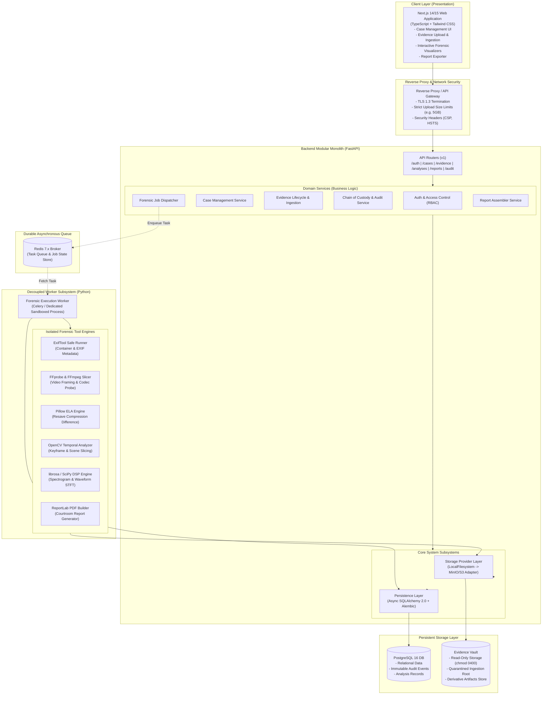
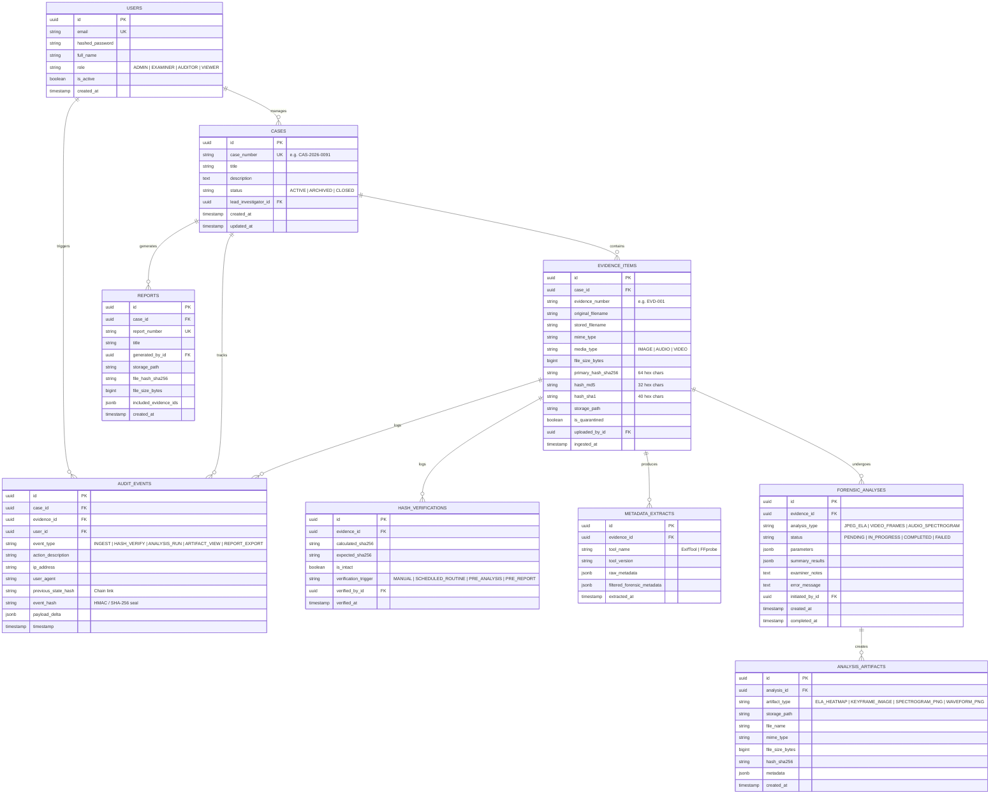

# PS-05 Digital Evidence Authenticity & Integrity Verification Platform
## System Architecture Specification

**Document Version:** 1.0.0  
**Status:** Approved Architectural Blueprint  
**System Classification:** High-Integrity Digital Forensics & Chain-of-Custody System  
**Standard Compliance:** ISO/IEC 27037, ISO/IEC 27042, NIST SP 800-86, Federal Rules of Evidence (FRE 901/902)

---

### 1. Executive Summary & Architectural Vision

The **PS-05 Digital Evidence Authenticity and Integrity Verification Platform** is an enterprise-grade, forensic-standard software platform designed to ingest, hash, analyze, verify, and report on digital media evidence (images, audio, and video).

The platform ensures:
1. **Absolute Integrity:** Guaranteed cryptographic baseline (SHA-256 alongside MD5/SHA-1 legacy cross-verification) computed at the exact stream ingestion boundary prior to persistent storage.
2. **Strict Chain of Custody:** Immutable, append-only, tamper-evident audit logging for every lifecycle event (ingestion, access, preview, analysis execution, report export).
3. **Forensic Soundness:** Execution of standard analytical heuristics (EXIF/container metadata extraction, Error Level Analysis (ELA), video keyframe slicing, and audio spectrogram/STFT frequency analysis) in isolated, resource-governed environments.
4. **Evidentiary Output:** Generation of courtroom-ready, cryptographically verifiable PDF examination reports with embedded hash seals and analysis summaries.

To achieve maintainability, strict security boundaries, and high computational scalability, the system is structured as a **Modular Monolith** paired with a **Decoupled Asynchronous Worker Process**.

---

### 2. High-Level System Architecture Diagram



---

### 3. Modular Monolith Architecture & Layer Separation

To eliminate accidental coupling while avoiding the excessive operational complexity of microservices, the system uses a **hexagonal / clean layer separation** within a unified backend repository:

```
backend/
├── app/
│   ├── api/             # Layer 1: HTTP Presentation (FastAPI Routers, Request/Response Pydantic Schemas)
│   ├── services/        # Layer 2: Business Logic & Orchestration (Pure Python Services)
│   ├── domain/          # Layer 3: Domain Models, Enums, Value Objects & Custom Exceptions
│   ├── db/              # Layer 4: Database Infrastructure (SQLAlchemy ORM models, Session Management)
│   ├── storage/         # Layer 5: Storage Abstraction (StorageProvider interface & concrete adapters)
│   ├── forensics/       # Layer 6: Forensic Analysis Engines (Independent tool drivers & analyzers)
│   ├── reports/         # Layer 7: ReportLab Document Generators & PDF Layout Templates
│   └── workers/         # Layer 8: Celery Task Definitions & Worker Entrypoints
```

#### Strict Architectural Boundaries & Invariants:
1. **API Routers (`app/api/`)** are strictly transport handlers. They validate incoming request payloads via Pydantic, authenticate the user session, invoke a domain service, and map domain results to JSON response schemas. No direct database queries or forensic tool invocations are permitted in routers.
2. **Domain Services (`app/services/`)** contain all business rules. They govern case access permissions, coordinate evidence ingestion, verify hashes, enforce audit log creation, and schedule asynchronous tasks.
3. **Database Access (`app/db/`)** uses SQLAlchemy 2.0 async sessions with strictly scoped unit-of-work patterns. ORM models never leave the service layer directly; they are mapped into explicit Pydantic DTOs before being handed to callers.
4. **Storage Subsystem (`app/storage/`)** is accessed solely via the `StorageProvider` abstract base class. Neither API routes nor forensic tools perform ad-hoc file I/O using hardcoded paths. All access is mediated by structured keys (`case_id/evidence_id/filename`).
5. **Forensics Engine (`app/forensics/`)** is completely decoupled from HTTP and database layers. Each analyzer is a stateless, pure functional unit that accepts a file path (or file-like stream) along with configuration parameters, executes deterministically, produces in-memory metrics or writes output derivative images (e.g., ELA heatmaps, spectrogram plots), and returns structured Pydantic result models.
6. **Report Engine (`app/reports/`)** is a standalone generator taking structured case data, evidence details, chain-of-custody logs, and analysis artifacts, rendering pixel-perfect, tamper-evident PDF documents via ReportLab.

---

### 4. Decoupled Asynchronous Worker Architecture

Forensic operations (decoding a 2-hour 4K video, computing Short-Time Fourier Transforms across high-sample-rate audio, running recursive container metadata extraction) are CPU- and memory-intensive. Running them inside the web server process would degrade API latency and risk Denial-of-Service.

#### Worker Subsystem Design:
- **Broker & Backend:** Redis 7.x acts as the queue broker and ephemeral result backend.
- **Worker Process:** Celery worker process runs separately from the FastAPI server. In Docker Compose, this is an independent container sharing the same code base and virtual environment but booted via `celery -A app.workers.celery_app worker`.
- **Durable Job State Management:**
  - Tasks report fine-grained progress states (`QUEUED`, `PROCESSING:EXTRACTING_FRAMES`, `PROCESSING:COMPUTING_ELA`, `COMPLETED`, `FAILED`).
  - Progress and results are mirrored in the PostgreSQL database (`forensic_analyses` table) so job state survives Redis reboots or task retries.
- **Worker Resource Isolation & Safeguards:**
  - Worker concurrency is strictly bound to CPU cores (e.g., `--concurrency=4`).
  - Worker recycling: `--max-tasks-per-child=50` to prevent unmanaged memory leaks from native C-extensions (OpenCV, librosa/FFmpeg bindings).
  - Task hard time limits (e.g., `--time-limit=900` for 15 minutes) and soft time limits (`--soft-time-limit=840`) to kill stuck operations safely.

---

### 5. Database Schema & Domain Entity Relationships

The relational model is optimized for transactional consistency, referential integrity, and evidentiary immutability.



---

### 6. Storage Provider Abstraction

Evidence files must be isolated from the OS file tree and protected from unauthorized modification.

```python
# Conceptual Architecture: Storage Provider Interface
class StorageProvider(ABC):
    @abstractmethod
    async def put_stream(self, key: str, stream: AsyncIterator[bytes], expected_size: int | None = None) -> StorageMetadata:
        """Stream evidence into storage, calculating hashes on the fly."""
        pass

    @abstractmethod
    async def get_stream(self, key: str) -> AsyncIterator[bytes]:
        """Retrieve stream for read-only forensic analysis."""
        pass

    @abstractmethod
    async def get_local_path_readonly(self, key: str) -> Path:
        """Provide a secure, read-only local path for external CLI tools (FFmpeg, ExifTool)."""
        pass

    @abstractmethod
    async def exists(self, key: str) -> bool:
        pass
```

- **LocalFilesystemStorageProvider (Default Phase 1):** Stores files in a secured directory outside the web application directory. Upon file completion, file attributes are marked read-only (`chmod 0400` in Linux/Docker) to prevent in-place tampering.
- **S3CompatibleStorageProvider (Target Adapter):** Integrates with AWS S3 or MinIO with S3 Object Lock (WORM - Write Once, Read Many) in compliance mode for absolute physical immutability.

---

### 7. Core Technology Stack & Architectural Justifications

| Component | Selected Technology | Architectural Justification |
| :--- | :--- | :--- |
| **Frontend Framework** | Next.js 14/15 (TypeScript) | Strong typing, Server-Side Rendering for fast authenticated dashboards, direct streaming response support, modern React architecture. |
| **Styling & Design** | Tailwind CSS | Utility-first, responsive, zero-runtime CSS, enabling precision UI for complex forensic data layouts and dark-mode data viewers. |
| **Backend Framework** | Python 3.11+ / FastAPI | High asynchronous concurrency via ASGI/Starlette, native Pydantic v2 data validation, native integration with the Python scientific and forensic ecosystem. |
| **ORM & Migrations** | SQLAlchemy 2.0 (Async) + Alembic | Enterprise relational mapping, strict type annotations, robust connection pooling, automated zero-downtime database schema migrations. |
| **Database** | PostgreSQL 16 | ACID-compliant transactional guarantees, rich `JSONB` support for arbitrary EXIF/FFprobe metadata structures, triggers for immutable audit logging. |
| **Background Queue** | Redis 7 + Celery | High-throughput in-memory message broker, durable task orchestration, support for worker task timeouts and memory recycling. |
| **Metadata Extraction** | Phil Harvey's ExifTool & FFprobe | The global forensic gold-standards for extracting thousands of nested EXIF, XMP, IPTC, MakerNotes, and container atom headers without executing malicious payloads. |
| **Video & Media Tools** | FFmpeg & OpenCV (`cv2`) | Standard tools for exact frame-level extraction, scene change detection, keyframe indexing, and spatial matrix comparisons. |
| **Image Analysis** | Pillow & NumPy | Direct pixel-matrix access, lossy JPEG re-quantization at exact quality factors, difference computation for Error Level Analysis (ELA). |
| **Audio Analysis** | librosa, SciPy, SoundFile | High-precision DSP audio processing: Short-Time Fourier Transforms (STFT), Mel-scaled spectrograms, chromagrams, and waveform envelope extraction. |
| **PDF Report Engine** | ReportLab (Platypus) | Deterministic, programmatic PDF rendering with support for exact millimeter positioning, custom vector canvas drawings, hash seals, and multi-page legal tables. |
| **Containerization** | Docker Compose | Multi-container reproducible development and deployment environment (frontend, backend, worker, postgres, redis, storage volumes). |
