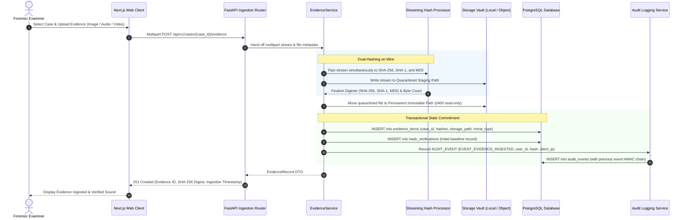
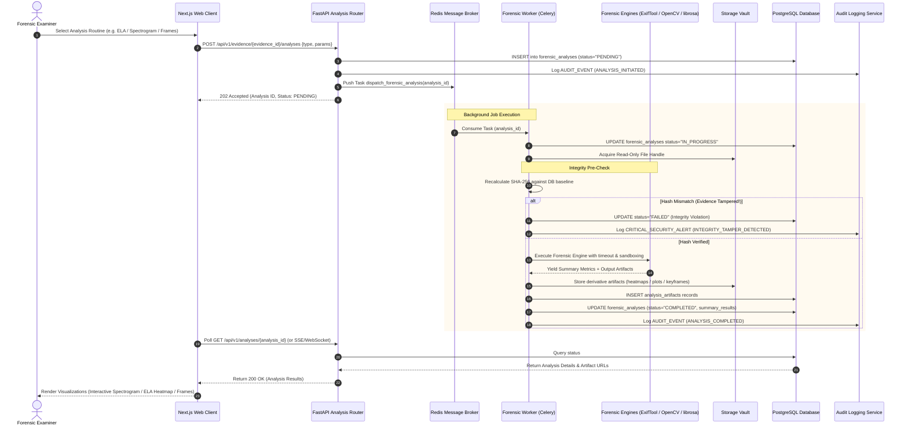
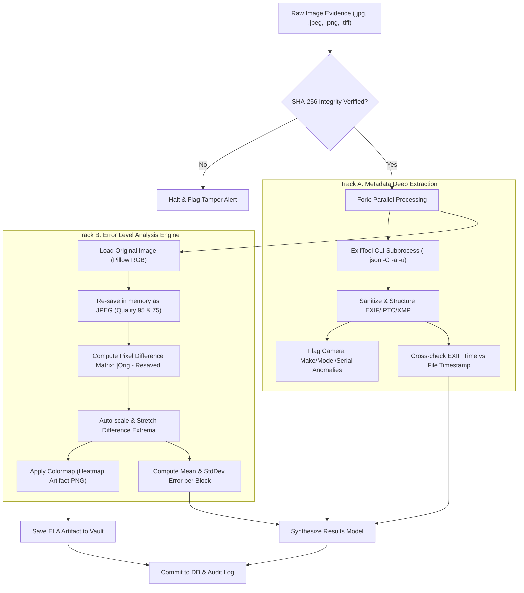
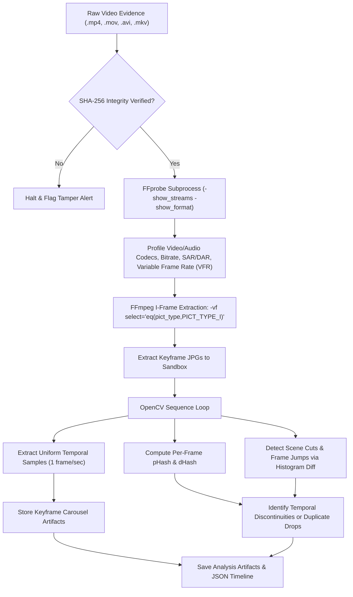
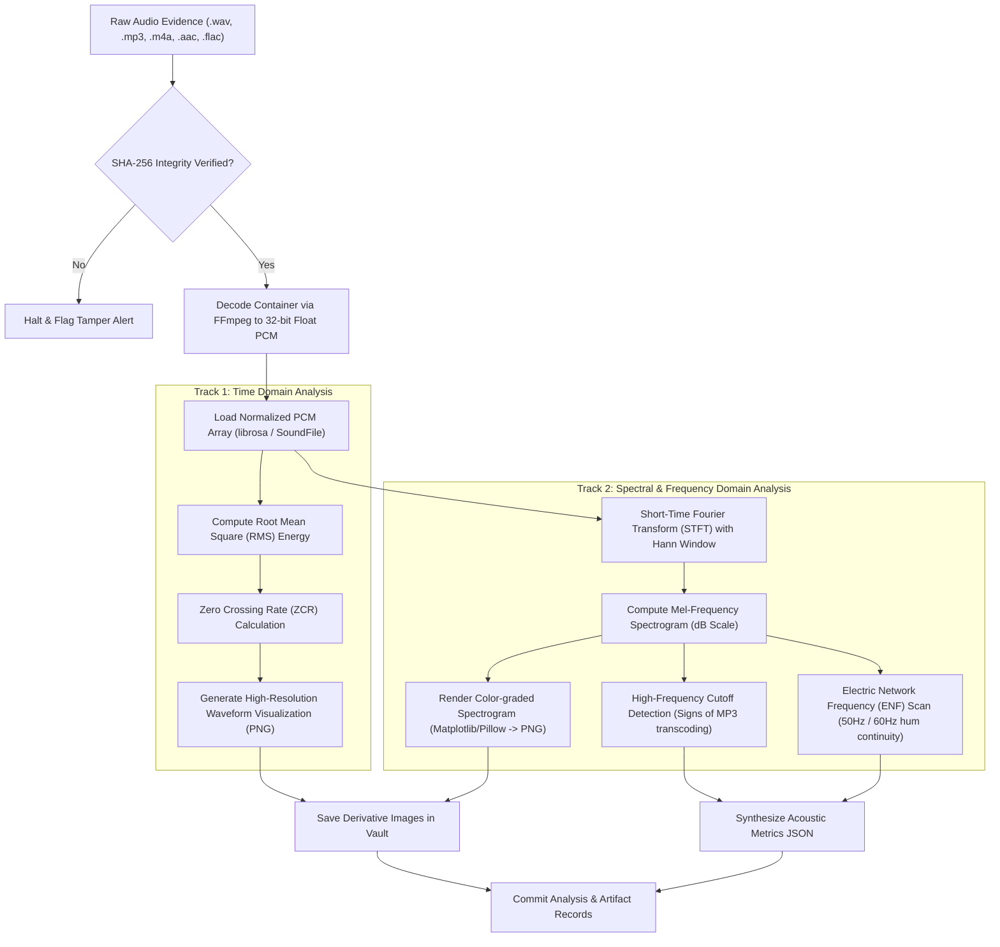
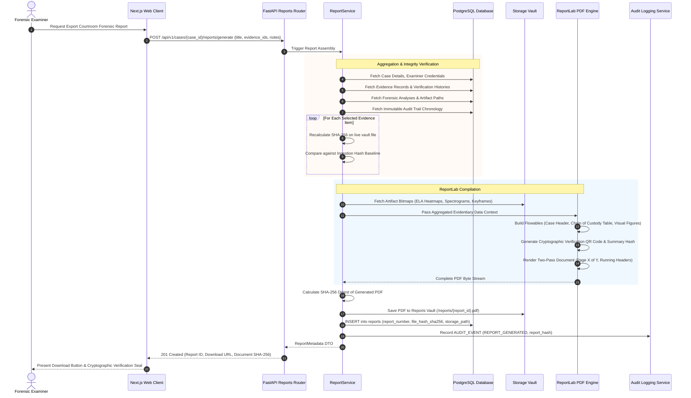
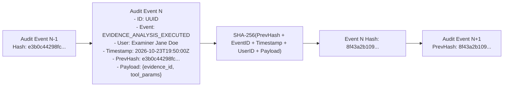

# PS-05 Digital Evidence Authenticity & Integrity Verification Platform
## Data Flow Specification

**Document Version:** 1.0.0  
**Status:** Approved Engineering Specification  
**Subject:** End-to-End Ingestion, Verification, Forensic Analysis, and Report Lifecycles

---

### 1. Ingestion & Cryptographic Baseline Pipeline

The ingestion pipeline must guarantee that evidence files cannot enter the platform without an immutable cryptographic fingerprint established at the raw network stream boundary.

#### Step-by-Step Ingestion Mechanics:
1. **Network Boundary Stream Interception:** The file stream is consumed chunk-by-chunk (e.g., 64 KB chunks). It is never loaded into RAM as a monolithic byte array.
2. **Concurrent Streaming Digests:** A dedicated multi-hasher updates Python `hashlib.sha256()`, `hashlib.sha1()`, and `hashlib.md5()` contexts simultaneously while streaming raw chunks directly to the storage driver.
3. **Quarantine Staging:** During transfer, the file resides in an isolated quarantine directory (`/storage/quarantine/{uuid}.tmp`). If the connection drops or the client aborts, the incomplete file is immediately scrubbed without touching the database.
4. **Locking & Permissions:** Once the stream closes and hashes match, the storage adapter moves the file into `/storage/vault/{case_id}/{evidence_id}/{filename}` and removes write permissions (`chmod 0400` in Linux/POSIX).
5. **Chain of Custody Initialization:** The first chain-of-custody entry is immutably committed with the examiner ID, timestamp, source IP address, and computed hash.

---

### 2. Forensic Analysis Pipeline (Asynchronous Worker Execution)

Once evidence is stored, examiners initiate targeted forensic analysis routines. Because these operations are computationally intensive, they are delegated via Redis to the Celery worker fleet.

---

### 3. Media-Specific Modality Pipelines

#### 3.1 Image Forensic Pipeline: Metadata & Error Level Analysis (ELA)

#### 3.2 Video Forensic Pipeline: Container Probing, Keyframe Indexing & Temporal Slicing

#### 3.3 Audio Forensic Pipeline: Codec Decoding, Waveform Envelope & Spectrogram Analysis

---

### 4. Courtroom PDF Report Compilation Data Flow

Generating a forensic examination report requires aggregating the complete evidentiary record, verifying that no data has changed, and compiling a tamper-evident document.

---

### 5. Chain-of-Custody & Audit Trail Integrity Flow

All security-sensitive operations generate immutable audit events. To prevent post-facto tampering with the database, events are secured using a cryptographic hash chain.

If an adversary alters a row in the `audit_events` table (for instance, changing an examiner ID or backdating an ingestion timestamp), the cryptographic hash chain breaks immediately. The platform's automated daily verification routine flags the tampering and identifies the exact corrupted block.
