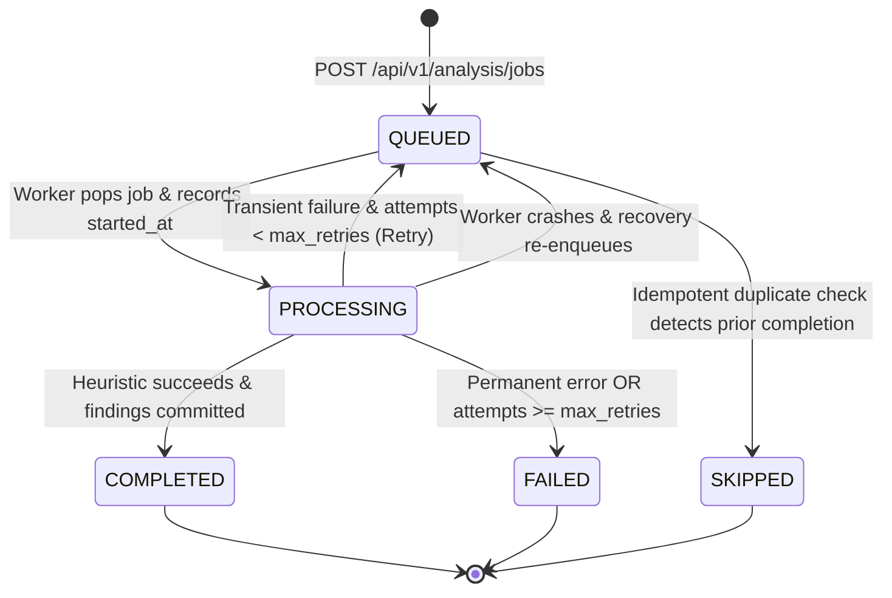

# Durable Background Analysis Jobs & Worker Fleet Specification

> **System Classification:** PS-05 Digital Forensics Platform — Asynchronous Compute Subsystem  
> **Status:** Production Standard  
> **Last Verified:** 2026-10-24  

---

## 1. Overview & Purpose

Forensic analysis heuristics (such as JPEG Error Level Analysis, temporal keyframe extraction, audio STFT spectral analysis, and container metadata parsing) are CPU- and memory-intensive operations. Running these computations inside the FastAPI HTTP request-response cycle would saturate the ASGI event loop, drop incoming connections, and risk HTTP timeouts on multi-gigabyte evidentiary media.

To guarantee high availability, system responsiveness, and courtroom-standard evidentiary integrity, the platform decouples task acceptance from task execution using a **durable background worker fleet** coordinated by **Redis Queue (RQ)** and backed by **PostgreSQL as the single source of truth**.

---

## 2. Authoritative State vs. Redis Transport Mechanics

A critical design requirement is clear separation of duties between persistence and transport:

| Concern | Primary Authority | Mechanism & Scope |
| :--- | :--- | :--- |
| **Definitive Job Identity** | **PostgreSQL** | Primary key UUID (`id`) in `forensic_analyses`. Courtroom-admissible record. |
| **Authoritative Lifecycle State** | **PostgreSQL** | Status column (`QUEUED`, `PROCESSING`, `COMPLETED`, `FAILED`, `SKIPPED`). |
| **Attempt Tracking** | **PostgreSQL** | `attempt_count`, `max_retries`, and `timeout_seconds`. |
| **Execution Diagnostics** | **PostgreSQL** | `error_code`, `error_message`, `started_at`, `last_heartbeat_at`, `completed_at`, `worker_id`. |
| **Evidentiary Results & Chain of Custody** | **PostgreSQL** | `summary_results` JSONB, foreign-keyed `findings` and `analysis_artifacts`. |
| **Transport Buffering & Work Stealing** | **Redis** | In-memory FIFO queue (`forensic_analysis`) managed by RQ. |
| **Worker Notification & Job Dispatch** | **Redis** | Pop semantics, worker assignment, and transient retry scheduling. |

### Why PostgreSQL is Authoritative
If Redis crashes, is restarted, or its in-memory state is flushed:
- **No data is lost.** All pending, in-flight, and completed jobs reside safely in PostgreSQL.
- **Worker Crash Recovery** periodically scans PostgreSQL for jobs in `PROCESSING` that missed heartbeats, re-enqueueing or finalizing them automatically.

---

## 3. Explicit Lifecycle State Machine

Forensic tasks progress through explicit lifecycle states:



### State Definitions
1. **`QUEUED`**: The job has been staged in PostgreSQL and placed onto the Redis transport queue. No worker has begun execution yet.
2. **`PROCESSING`**: A worker popped the job, incremented `attempt_count`, recorded `started_at`, set `worker_id`, and updated `last_heartbeat_at`.
3. **`COMPLETED`**: The heuristic completed successfully. Verified findings and artifacts are committed, `summary_results` written, and `completed_at` stamped.
4. **`FAILED`**: The heuristic encountered a permanent error or exceeded bounded retries. An explicit `error_code` and descriptive message are persisted.
5. **`SKIPPED`**: Returned when an examiner submits an identical request whose results already exist and remain intact.

---

## 4. Idempotency Protection

To protect against duplicate submissions (such as network retries or double clicks), the platform provides two layers of idempotency:

1. **Explicit Idempotency Key**: Examiners or client applications can pass an `idempotency_key` via JSON body or `X-Idempotency-Key` HTTP header. If a job with this key already exists:
   - If `QUEUED` or `PROCESSING`: Returns the active job (HTTP 200/202).
   - If `COMPLETED`: Returns the finalized results without re-enqueuing.
2. **In-Flight Active Job Guard**: If an examiner initiates an analysis on an evidence item while a task of the exact same `analysis_type` is already `QUEUED` or `PROCESSING`, the system returns the existing active job rather than spawning duplicate worker load.

---

## 5. Finding Deduplication on Task Retries

When a task fails midway through execution (e.g. after inserting partial findings) and is retried:
- Simply appending findings on each attempt would result in duplicate anomalies and corrupt forensic reporting.
- **Deduplication Rule**: When `run_analysis_job` transitions to `PROCESSING` on any attempt, it executes:
  ```python
  await finding_repo.clear_findings_for_analysis(analysis_id)
  ```
- Any findings generated by previous failed attempts are atomically purged within the transaction before new findings are staged. Each completed analysis contains precisely one clean set of findings.

---

## 6. Worker Crash Recovery & Interrupted Job Reconciliation

If a worker process is killed (`SIGKILL`, OOM killer, power failure, or node crash):
- Without recovery, jobs would remain stuck in `PROCESSING` indefinitely.
- The platform implements **two recovery mechanisms**:
  1. **Worker Boot Recovery**: When `ForensicWorker` starts up, it immediately scans for interrupted tasks:
     ```python
     await worker.run_crash_recovery()
     ```
  2. **Watchdog Query**: Identifies tasks where `status == 'PROCESSING'` and `last_heartbeat_at < NOW() - 60s`.
     - If `attempt_count < max_retries`: Increments `attempt_count`, marks `error_code="WORKER_CRASHED_RECOVERED"`, resets status to `QUEUED`, and re-enqueues into Redis.
     - If `attempt_count >= max_retries`: Marks `status="FAILED"`, `error_code="WORKER_CRASHED"`, `error_message="Worker process died while processing and exceeded maximum retries"`, `completed_at=NOW()`.

---

## 7. HTTP API Reference

### 1. Enqueue Analysis Job
- **`POST /api/v1/analysis/jobs`**
- **Status:** `202 Accepted`
- **Request Body:**
  ```json
  {
    "evidence_id": "923dddc4-e255-4f56-9223-a5bb16450d4a",
    "analysis_type": "TEST_ANALYSIS",
    "parameters": { "test_key": "val" },
    "idempotency_key": "CUSTOM-IDEMP-KEY-001",
    "max_retries": 3,
    "timeout_seconds": 300
  }
  ```
- **Response:**
  ```json
  {
    "job_id": "05076134-6cba-4117-ab22-15e23a7b0a00",
    "analysis_id": "923dddc4-e255-4f56-9223-a5bb16450d4a",
    "evidence_id": "923dddc4-e255-4f56-9223-a5bb16450d4a",
    "analysis_type": "TEST_ANALYSIS",
    "status": "QUEUED",
    "message": "Analysis job successfully queued for execution",
    "created_at": "2026-10-24T14:40:00Z"
  }
  ```

### 2. Poll Job Status
- **`GET /api/v1/analysis/jobs/{job_id_or_analysis_id}`**
- Returns authoritative state, worker assignment, timestamps, error diagnostics, summary results, and findings.

### 3. Query Analysis History
- **`GET /api/v1/analysis/history?status=COMPLETED&page=1&page_size=20`**
- Returns paginated list of analysis records.

### 4. Retry Failed Job
- **`POST /api/v1/analysis/jobs/{analysis_id}/retry`**
- Re-enqueues a failed or terminated job.

---

## 8. Standalone Worker Execution

The worker is completely decoupled from FastAPI and can run as an independent process or in container fleets:

```bash
# Production daemon mode
python -m app.worker

# Burst mode (batch processing / CI automated tests)
python -m app.worker --burst

# Crash recovery check only
python -m app.worker --recover-only
```
